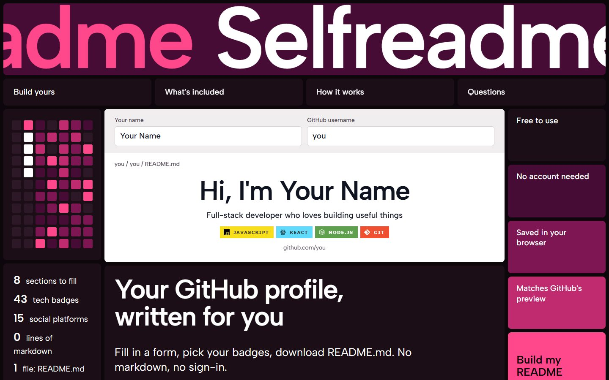
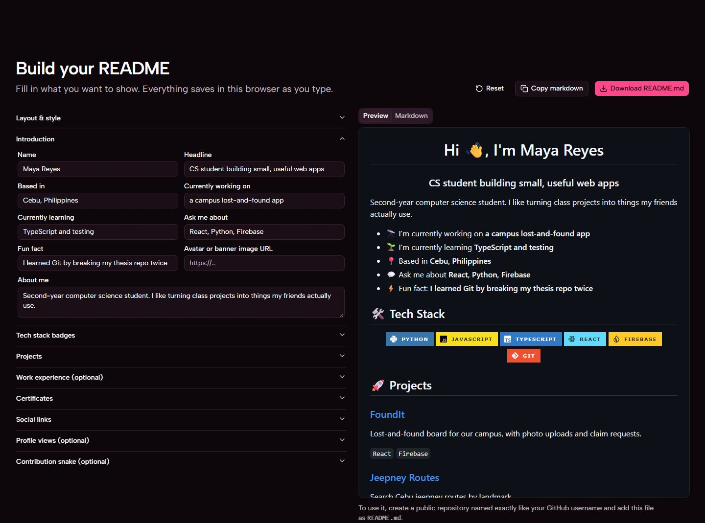

# Selfreadme

**Build your GitHub profile README from a form. No markdown, no sign-in.**

Selfreadme turns a few fields and clicks into a finished `README.md` for your GitHub profile: an introduction, tech badges, projects, certificates, social links, a contribution snake and a profile views counter. You see the result as GitHub will show it, then copy or download the file.

**[Use Selfreadme →](https://khryz-navarro.github.io/selfreadme/)**



## Features

- **No markdown.** Every part of the profile is a form field, a switch or a button.
- **Live preview.** Your README renders with GitHub's own markdown styles as you type, with a tab that shows the markdown behind it.
- **Tech badges.** 43 one-click presets (Python, React, Docker, Figma...) plus custom badges with any [Simple Icons](https://simpleicons.org) logo, as [shields.io](https://shields.io) badges in five styles.
- **Everything a profile needs.** Introduction, projects, work experience, certificates and links to 15 platforms, including GitHub, LinkedIn, X, Dev.to, LeetCode and email.
- **Contribution snake.** An animated snake eating your contribution graph, with the GitHub Action ready to copy.
- **Profile views counter.** An optional badge that counts visits to your profile.
- **Your layout.** Turn sections on and off, rename their headings and change their order.
- **Private.** No account and no server: your profile is saved in your own browser.



## How it works

1. Open [Selfreadme](https://khryz-navarro.github.io/selfreadme/) and fill in the editor.
2. Click **Download README.md** (or **Copy markdown**).
3. On GitHub, create a public repository named exactly like your username, for example `octocat/octocat`, and add the file as `README.md`.

GitHub shows that file at the top of your profile. The [user guide](docs/user-guide.md) walks through every step, including the snake and the views counter.

## Run it locally

You need [Node.js](https://nodejs.org) 22.18 or newer.

```bash
git clone https://github.com/Khryz-Navarro/selfreadme.git
cd selfreadme
npm install
npm run dev
```

Then open the address Vite prints, usually <http://localhost:5173/>. The [developer guide](docs/developer-guide.md) covers the scripts, the code and how deployment works.

## Documentation

| Guide | For |
| --- | --- |
| [User guide](docs/user-guide.md) | Making and publishing your profile README, step by step |
| [Developer guide](docs/developer-guide.md) | Stack, project structure, the markdown generator, testing and deployment |
| [FAQ](docs/faq.md) | Common questions and known limits |
| [Roadmap](docs/roadmap.md) | What's planned next |
| [Contributing](CONTRIBUTING.md) | How to report issues and send pull requests |

## Built with

[React](https://react.dev), [Vite](https://vite.dev), [TypeScript](https://www.typescriptlang.org), [Tailwind CSS](https://tailwindcss.com) and [shadcn/ui](https://ui.shadcn.com). Deployed to GitHub Pages by GitHub Actions.

## Credits

- Badges by [shields.io](https://shields.io), with logos from [Simple Icons](https://simpleicons.org).
- Profile view counts by [komarev.com](https://komarev.com/ghpvc/).
- The contribution snake is drawn by [Platane/snk](https://github.com/Platane/snk); the published workflow uses [crazy-max/ghaction-github-pages](https://github.com/crazy-max/ghaction-github-pages) to store it.
- README previews use [github-markdown-css](https://github.com/sindresorhus/github-markdown-css) and [marked](https://marked.js.org).
- The repository includes two design skills used while building the site: [taste-skill](https://github.com/Leonxlnx/taste-skill) (MIT) in `.agents/` and [impeccable](https://github.com/pbakaus/impeccable) (Apache-2.0) in `.claude/skills/`, each with its own licence.

Selfreadme is not affiliated with GitHub.

## Licence

[MIT](LICENSE) © Khryz-Navarro. The bundled design skills keep their own licences.
