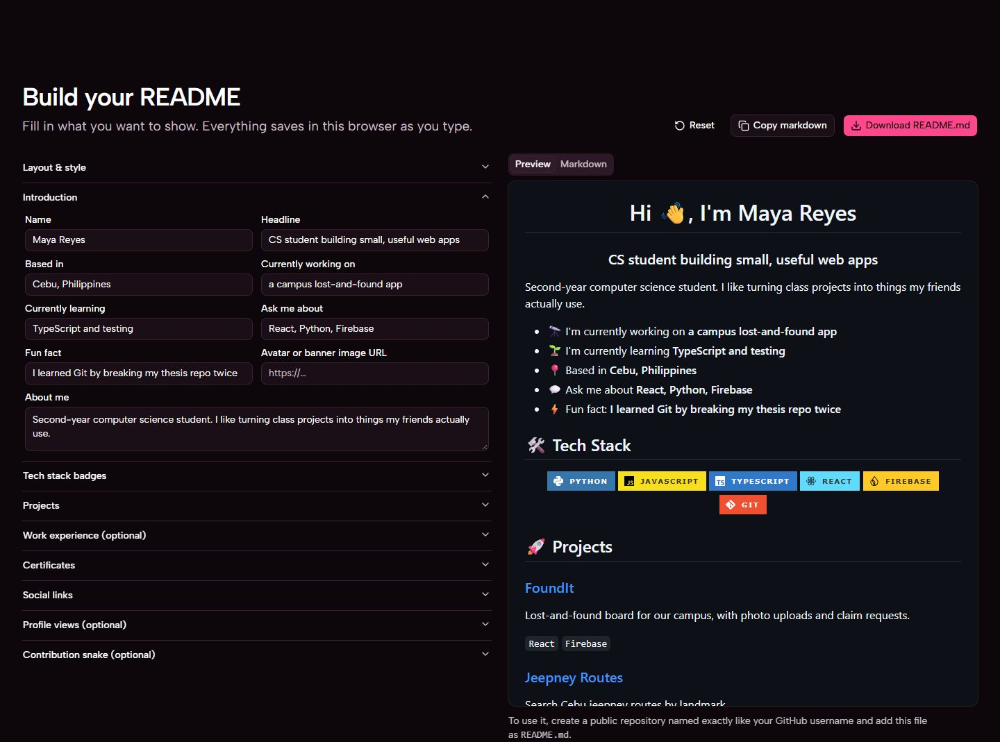
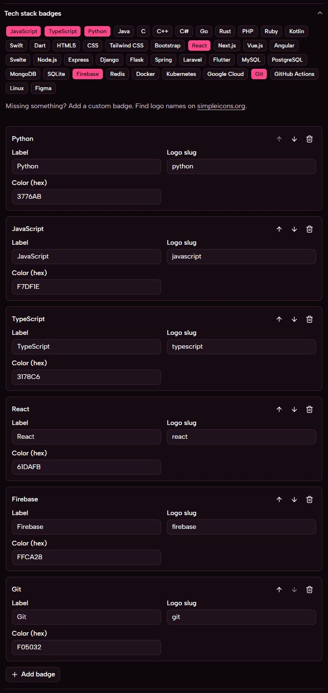
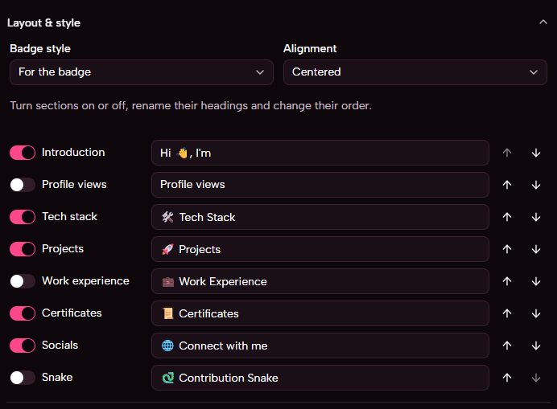
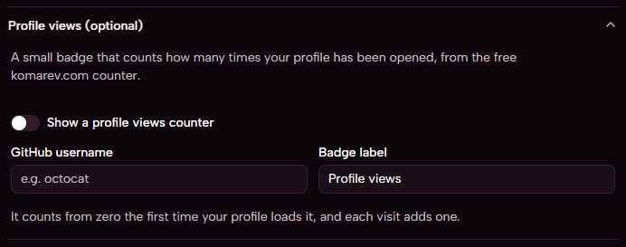
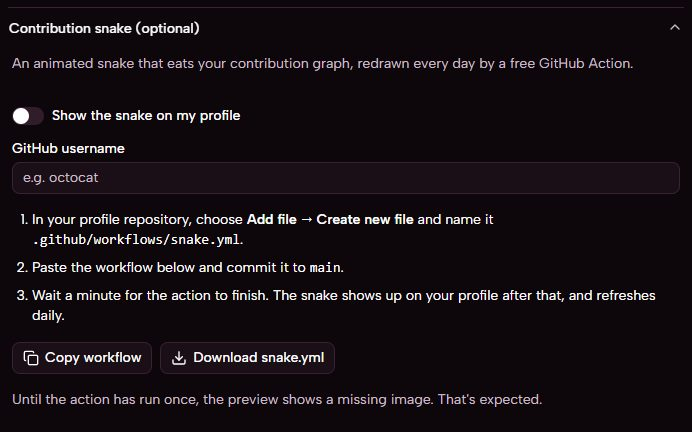
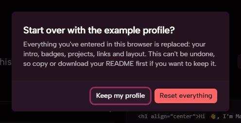

# User guide

This guide takes you from nothing to a finished GitHub profile README. You don't need to know markdown or HTML.

- [What you're making](#what-youre-making)
- [1. Open the editor](#1-open-the-editor)
- [2. Fill in your introduction](#2-fill-in-your-introduction)
- [3. Add tech badges](#3-add-tech-badges)
- [4. Projects, experience and certificates](#4-projects-experience-and-certificates)
- [5. Social links](#5-social-links)
- [6. Layout and style](#6-layout-and-style)
- [7. Profile views counter](#7-profile-views-counter)
- [8. Contribution snake](#8-contribution-snake)
- [9. Download and publish](#9-download-and-publish)
- [Saving, updating and starting over](#saving-updating-and-starting-over)

## What you're making

GitHub has a special repository: one named exactly like your username. If your username is `octocat`, it's `github.com/octocat/octocat`. Whatever is in that repository's `README.md` appears at the top of your profile, above your pinned repositories. It's the first thing a recruiter or classmate reads.

Selfreadme writes that `README.md` for you.

## 1. Open the editor

Go to [khryz-navarro.github.io/selfreadme](https://khryz-navarro.github.io/selfreadme/). The editor is on the same page, right after the top section. Click **Build my README** or **Build yours** to jump to it.

The top section has a small live card. Typing your name and GitHub username there fills them into the editor too.

The editor has two halves:

- **Left:** the form, split into sections. Click a section's name to open or close it.
- **Right:** the preview. **Preview** shows your README as GitHub will show it; **Markdown** shows the file it will download.

Everything you type is saved in your browser straight away. There's no save button.

## 2. Fill in your introduction

Open **Introduction** and fill in what you want to show. Every field is optional; empty ones are left out of the README.

| Field | Appears as |
| --- | --- |
| Name | The large greeting, "Hi 👋, I'm …" |
| Headline | A line under your name, such as "CS student building small web apps" |
| About me | A short paragraph |
| Currently working on, Currently learning, Based in, Ask me about, Fun fact | A bulleted list, each with its own emoji |
| Avatar or banner image URL | An image under your headline. Use a link to an image that's already online. |

## 3. Add tech badges

Open **Tech stack badges**. Tap any of the 43 presets to add it, and tap it again to remove it. Badges you've picked are highlighted.

Each badge you add appears in a list below the presets, where you can:

- change its **label** (the text on the badge)
- change its **logo slug**, the logo's name on [simpleicons.org](https://simpleicons.org) (for example `react` or `nodedotjs`)
- change its **colour** as a hex code, without the `#` (for example `61DAFB`)
- move it up or down, or remove it

**Missing a technology?** Click **Add badge** and fill in the three fields yourself. Search [simpleicons.org](https://simpleicons.org) for the logo; its slug is the lowercase name shown on its page. If a badge shows no logo, the slug probably doesn't exist in shields.io's icon set, so double-check the spelling.

Selfreadme picks a dark or white logo automatically so it stays readable on the badge colour.

## 4. Projects, experience and certificates

These three sections work the same way: click **Add** to make an entry, fill in its fields, and use the arrows to reorder or the bin to delete.

- **Projects:** name, link, description, and tech used. Separate technologies with commas (`React, Firebase`); each becomes a small tag.
- **Work experience (optional):** role, company, start, end and what you did. Leave **End** empty to show "Present".
- **Certificates:** name, issuer, date and a credential link.

An entry without a name (or, for jobs, without a role or company) is left out of the README, so a half-filled entry won't show up.

## 5. Social links

Open **Social links** and add one entry per platform. Pick the platform, then paste the full link to your page. Each becomes a coloured badge that links there.

Supported platforms: GitHub, LinkedIn, X, Instagram, Facebook, YouTube, Dev.to, Medium, Hashnode, Discord, Stack Overflow, Kaggle, LeetCode, Portfolio (any website) and Email.

For **Email**, type just your address, such as `you@example.com`. Selfreadme turns it into an email link.

Your GitHub link does double duty: the snake and the views counter read your username from it if you haven't typed one in.

## 6. Layout and style

Open **Layout & style** to change how the whole README looks.

- **Badge style:** *For the badge* (large, uppercase), *Flat*, *Flat square*, *Plastic* or *Social*. It applies to every badge.
- **Alignment:** *Centered* or *Left*.
- **Sections:** for each section, a switch turns it on or off, the text field renames its heading, and the arrows move it up or down. The Introduction's heading is the greeting before your name, "Hi 👋, I'm" by default.

## 7. Profile views counter

The counter is a small badge showing how many times your profile has been opened. It's off by default.

1. Open **Profile views (optional)** and switch on **Show a profile views counter**.
2. Make sure Selfreadme knows your GitHub username: type it in the field, or add your GitHub link under Social links.
3. Optionally change the **Badge label**, which is "Profile views" by default.

By default the counter sits right under your introduction. Move it in **Layout & style** like any other section.

The count comes from the free [komarev.com](https://komarev.com/ghpvc/) counter. It starts from zero the first time your profile loads it, and every page load adds one, including your own visits.

## 8. Contribution snake

The snake is an animation of a snake eating your contribution graph (the green squares on your profile). GitHub redraws it every day with a small automated task called a GitHub Action.

1. Open **Contribution snake (optional)** and switch on **Show the snake on my profile**.
2. Make sure your GitHub username is filled in (here or through your GitHub link).
3. Click **Copy workflow** (or **Download snake.yml**).
4. In your profile repository on GitHub, choose **Add file → Create new file**, name it `.github/workflows/snake.yml`, paste the workflow and commit it to `main`.
5. Wait a minute or two. The action draws the snake and saves it to a branch called `output`, where your README picks it up.

From then on it redraws itself every day. You can also run it by hand from the repository's **Actions** tab.

Until the action has run once, the preview (and your profile) shows a missing image. That's expected.

## 9. Download and publish

1. Click **Download README.md** at the top of the editor, or **Copy markdown** to copy the text.
2. On GitHub, create a **new repository** named exactly like your username, set it to **Public**, and tick **Add a README file**. GitHub may show a note saying it's a special repository; that's the one.
3. Open its `README.md`, click the pencil icon to edit, replace everything with your file's contents, and commit. (Or upload your downloaded `README.md` with **Add file → Upload files**.)
4. Visit `github.com/<your-username>`. Your new README is at the top.

## Saving, updating and starting over

**Saving.** Your profile is saved in this browser automatically, so you can close the tab and come back later. It isn't sent anywhere and isn't synced between devices or browsers.

**Updating later.** Come back in the same browser, change what you need, download again, and replace `README.md` in your profile repository.

**Clearing browser data** (or a private window) loses your saved profile. Keep your downloaded `README.md` as a backup.

**Starting over.** Click **Reset** at the top of the editor. Selfreadme asks first; **Reset everything** replaces your profile with the example one and can't be undone, while **Keep my profile** or <kbd>Esc</kbd> leaves it as it is.

---

More questions? See the [FAQ](faq.md).
